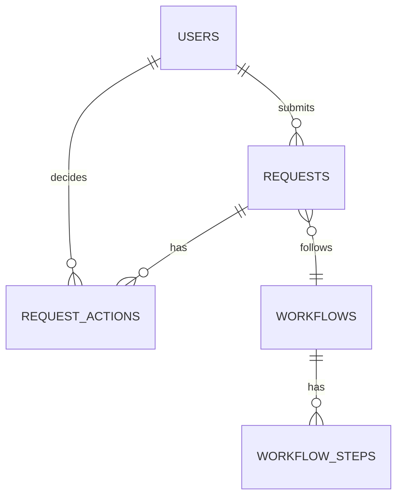

# FlowDesk


Workflow automation REST API built with FastAPI and PostgreSQL.

I worked for three years as a Customer Service and Digitalization Agent, where I saw how much time teams lose on internal approvals that live in emails and spreadsheets: nobody knows who has to approve next, and there is no clear history of who decided what. FlowDesk is my attempt to model that process as a backend service: requests move through configurable approval steps, and every decision is recorded.

## ✨ Features

- **JWT authentication** with Argon2 password hashing
- **Role-based access control** (employee, manager, finance, admin)
- **Configurable approval workflows**: an admin defines ordered steps and the role that approves each one
- **Request lifecycle**: `DRAFT → PENDING → APPROVED / REJECTED`
- **Approval engine**:
  - only the role of the current step can decide
  - nobody can approve their own request (separation of duties)
  - a rejection requires a comment
  - row locking (`SELECT ... FOR UPDATE`) prevents two approvers from moving a request twice
- **"Pending for me"** inbox for each approver
- **Full approval history**: who decided, at which step, with what comment
- **22 automated tests** running on every push with GitHub Actions

## 🛠️ Tech stack

- Python 3.15, FastAPI
- PostgreSQL 16 (Docker)
- SQLAlchemy 2.0 (ORM), Alembic (migrations)
- Pydantic, Pydantic Settings (validation, env-based configuration)
- PyJWT, pwdlib with Argon2 (authentication)
- pytest, GitHub Actions (testing, CI)

## 🗂️ Data model



| Table | Purpose |
|---|---|
| `users` | People who submit or approve requests, each with a role |
| `workflows` | A request type, e.g. "Expense" or "Leave" |
| `workflow_steps` | The ordered approval steps of a workflow and which role approves each one |
| `requests` | A submitted request, its status (draft, pending, approved, rejected) and its current step |
| `request_actions` | The approval history: one row per decision |

## 🔌 API overview

| Method | Endpoint | Access | Description |
|---|---|---|---|
| POST | `/auth/register` | Public | Create an account (always as employee) |
| POST | `/auth/login` | Public | Get a JWT access token |
| GET | `/auth/me` | Authenticated | Current user |
| GET | `/users` | Admin | List users (paginated) |
| PATCH | `/users/{id}/role` | Admin | Change a user's role |
| POST | `/workflows` | Admin | Create a workflow with its steps |
| GET | `/workflows` | Authenticated | List workflows |
| PUT | `/workflows/{id}` | Admin | Replace a workflow and its steps |
| DELETE | `/workflows/{id}` | Admin | Delete a workflow (blocked if it has requests) |
| POST | `/requests` | Authenticated | Create a draft request |
| GET | `/requests/mine` | Authenticated | My requests, optional `?status=` filter |
| GET | `/requests/pending-for-me` | Authenticated | Requests waiting for my role |
| POST | `/requests/{id}/submit` | Requester | `DRAFT → PENDING` |
| POST | `/requests/{id}/approve` | Approver of current step | Move to the next step or approve |
| POST | `/requests/{id}/reject` | Approver of current step | Reject with a comment |
| GET | `/requests/{id}/actions` | Requester, approvers, admin | Approval history |

Full interactive documentation at `/docs` (Swagger UI).

## 🚀 Getting started

Requirements: Python 3.11+, Docker.

```bash
git clone https://github.com/nasia19941/flowdesk.git
cd flowdesk
docker compose up -d
python -m venv venv
source venv/bin/activate
pip install -r requirements.txt
cp .env.example .env
```

Generate a secret key and put it in `.env` as `SECRET_KEY`:

```bash
python -c "import secrets; print(secrets.token_hex(32))"
```

Then run the migrations and start the server:

```bash
alembic upgrade head
uvicorn app.main:app --reload
```

- API docs: http://127.0.0.1:8000/docs
- Health check: http://127.0.0.1:8000/health

### First admin

Registration always creates an employee, so nobody can make themselves an admin through the API. Register a user, then promote it directly in the database:

```bash
docker exec -it flowdesk-db psql -U flowdesk -d flowdesk \
  -c "UPDATE users SET role = 'ADMIN' WHERE email = 'you@example.com';"
```

## 🧪 Running tests

```bash
docker exec -it flowdesk-db createdb -U flowdesk flowdesk_test
pytest -v
```

The tests run against a real PostgreSQL database (`flowdesk_test`). Each test runs inside a transaction that is rolled back at the end, so tests never affect each other. They cover authentication, role-based access, workflow management and the full approval flow.

On every push, GitHub Actions starts a PostgreSQL service, runs the Alembic migrations on an empty database and then runs the test suite.

## 🧩 Challenges

**PostgreSQL ENUM types and Alembic.** PostgreSQL stores an enum as a separate type, outside the table. I ran into two problems with this:

1. Alembic's autogenerated `downgrade()` drops the table but not the enum type. The next upgrade then failed with `type "role" already exists`. I fixed it by dropping the type manually at the end of `downgrade()`, so every migration removes what it creates.
2. The `workflow_steps` table reuses the `role` enum that the users migration already created. Autogenerate tried to create it again, so I changed the column to `postgresql.ENUM(name="role", create_type=False)`. I also left the type out of that migration's `downgrade()`, because the `users` table still depends on it.

The lesson for me: autogenerated migrations are a starting point, and I read and test every one (`upgrade`, `downgrade -1`, `upgrade`) before committing. The CI now also runs all migrations on an empty database, because the tests create tables from the models and would not catch a broken migration.

**Money values.** I store `amount` as `Numeric(10, 2)` and not as a float, because floats can't represent decimal values exactly (`0.1 + 0.2 != 0.3`).

**Concurrent approvals.** If two approvers click "approve" at the same moment, both could read the same step and move the request forward twice. The approve and reject endpoints load the request with `SELECT ... FOR UPDATE`, so the second approver waits, then sees the updated step and is rejected by the role check.

**Testing code that commits.** The endpoints call `commit()`, which would normally make test data permanent. The test session uses `join_transaction_mode="create_savepoint"`, so each commit only closes a savepoint inside an outer transaction that is rolled back after every test.

## 🗺️ Roadmap

- [x] Project setup with Docker, SQLAlchemy and Alembic
- [x] Data model: users, workflows, steps, requests, approval history
- [x] JWT authentication with role-based access
- [x] CRUD endpoints for workflows and requests
- [x] Approval engine (state machine for request status)
- [x] Tests with pytest and CI with GitHub Actions
- [ ] Deployment
- [ ] Email notifications when a request reaches an approver
- [ ] Block step changes on workflows that have pending requests